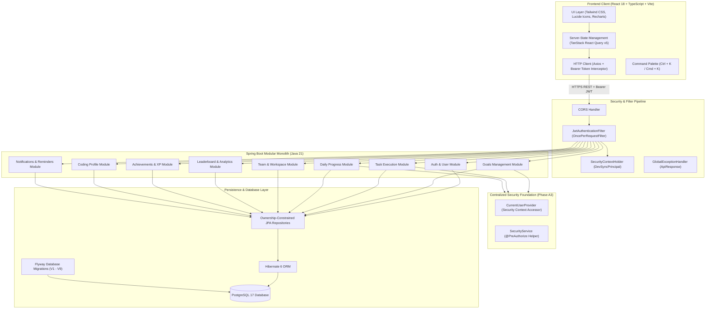
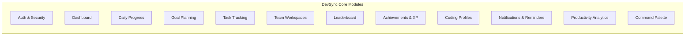
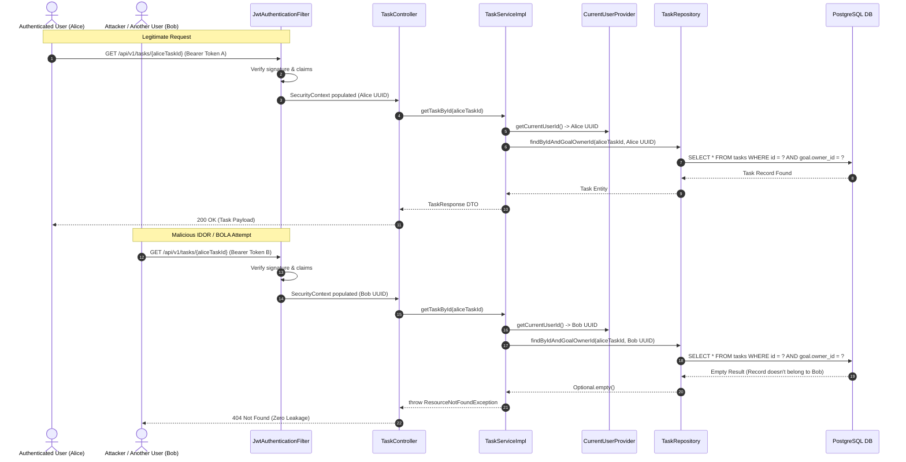
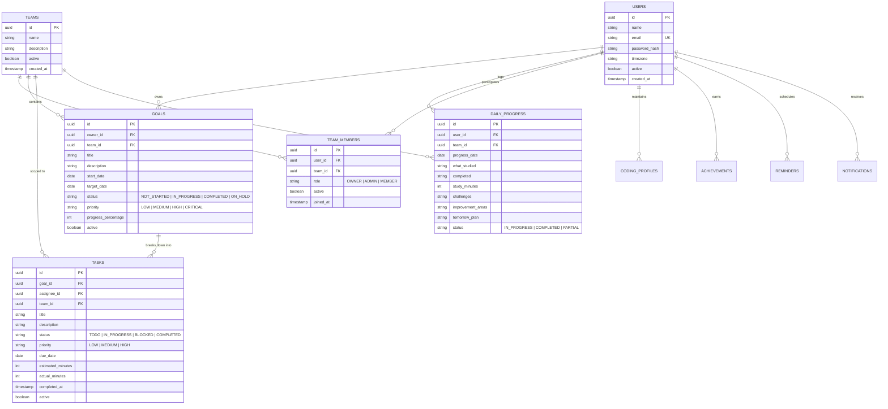

# DevSync
> **Private Developer Productivity, Accountability & Growth Platform**

[](https://openjdk.org/)
[](https://spring.io/projects/spring-boot)
[](https://spring.io/projects/spring-security)
[](https://www.postgresql.org/)
[](https://flywaydb.org/)
[](https://react.dev/)
[](https://www.typescriptlang.org/)
[](https://vitejs.dev/)
[](https://tailwindcss.com/)
[](https://github.com/RANAPRINCE06/DevSync)
[](LICENSE)

---

## 1. Project Overview

**DevSync** is a private developer productivity, accountability, and technical growth platform engineered for individual software engineers, competitive programmers, and small collaborative squads.

Developers routinely struggle with:
- Maintaining consistent daily programming and study habits.
- Tracking learning velocity across multiple technical roadmaps.
- Breaking long-term career or contest milestones into actionable daily tasks.
- Maintaining mutual accountability within coding peer groups.
- Consolidating competitive programming metrics (LeetCode, Codeforces, GitHub) into a single dashboard.

Rather than functioning as a generic task-management tool, **DevSync** combines **developer accountability**, **hierarchical goal & task planning**, **daily progress tracking**, **team workspaces**, **gamified XP & leaderboards**, and **deep security & IDOR protection**.

---

## 2. System Architecture

DevSync is designed as a **Modular Monolithic Architecture**. The backend is maintained as a cohesive Spring Boot 3.4.3 application divided into decoupled business modules, communicating via strict service contracts and type-safe DTOs without premature distributed-system overhead.

### 2.1 High-Level Architecture



### 2.2 Layered Backend Architecture

Every backend module adheres to strict layer separation:

```
[ HTTP Request ]
       │
       ▼
1. Controller Layer   ─── Request validation (@Valid DTOs), HTTP status codes, Swagger/OpenAPI docs
       │
       ▼
2. Service Layer      ─── Transaction management (@Transactional), business invariants,
                          authenticated caller extraction via CurrentUserProvider,
                          authorization decisions, metric updates
       │
       ▼
3. Repository Layer   ─── Ownership-constrained JPQL queries (e.g. findByIdAndOwnerId),
                          Spring Data JPA Specifications for dynamic filtering
       │
       ▼
4. Database Layer     ─── PostgreSQL 17 relational storage, schema constraints, Flyway migrations
```

### 2.3 Frontend Client Architecture

```
[ Browser / Client ]
       │
       ▼
React Router v7       ─── ProtectedRoute (guarded with JWT check) & PublicRoute (login/register)
       │
       ▼
AuthContext           ─── JWT token storage (localStorage/sessionStorage), principal state, logout
       │
       ▼
TanStack Query v5     ─── Stale-while-revalidate caching, optimistic mutations, query invalidation
       │
       ▼
Axios Interceptor     ─── Automatically injects `Authorization: Bearer <jwt>`, handles 401 redirect
       │
       ▼
Pages & Components    ─── Dashboard, Goals, Tasks (Kanban/List), Progress, Teams, Leaderboard,
                          Command Palette (`Ctrl+K`), Theme Toggle (Dark/Light/System)
```

---

## 3. Technology Stack

### 3.1 Backend Technologies

| Technology | Version | Purpose |
|---|---|---|
| **Java** | 21 (LTS) | Modern Java runtime (records, pattern matching, virtual threads ready) |
| **Spring Boot** | 3.4.3 | Application framework and dependency injection |
| **Spring Security** | 6.4 | Stateless authentication, authorization filter chain, method security |
| **Spring Data JPA** | 3.4.3 | Repository persistence, dynamic Specifications, JPQL queries |
| **Hibernate** | 6.6 | Object-Relational Mapping (ORM) and entity lifecycle management |
| **PostgreSQL** | 17 | Production relational database engine |
| **Flyway** | 10.x | Schema versioning and reproducible database migrations |
| **JJWT** | 0.12.6 | RFC 7519 cryptographically signed HMAC-SHA256 (HS256) JWTs |
| **Lombok** | 1.18 | Boilerplate reduction for builders and accessors |
| **Springdoc OpenAPI** | 2.8 | Interactive OpenAPI v3 specification and Swagger UI |
| **Spring Boot Actuator**| 3.4.3 | Application health metrics (`/actuator/health`, `/actuator/info`) |
| **JUnit 5 & Mockito** | Latest | Unit testing, WebMvc slices, and cross-user integration tests |
| **Maven** | 3.9+ | Build and dependency lifecycle automation |

### 3.2 Frontend Technologies

| Technology | Version | Purpose |
|---|---|---|
| **React** | 18.3 | Declarative component UI library |
| **TypeScript** | 5.x | End-to-end static typing and interface definitions |
| **Vite** | 6.x | Fast dev server and optimized Rollup production bundler |
| **Tailwind CSS** | 3.4 | Utility-first CSS styling with dark/light theme support |
| **TanStack React Query**| v5 | Asynchronous server-state synchronization and caching |
| **React Router** | v7 | Single-page application client routing and route guards |
| **Axios** | 1.7 | HTTP client with automatic Authorization header injection |
| **Lucide React** | Latest | Clean, accessible icon system |
| **Recharts** | 2.x | Responsive SVG charts and productivity visualizations |

---

## 4. Core Application Modules



### 4.1 Authentication & User Management
- User registration with real-time client & server password validation.
- Secure login verifying PBKDF2 password hashes.
- Stateless HS256 JWT generation with 24-hour expiration.
- Centralized `CurrentUserProvider` extracting verified `DevSyncPrincipal` from `SecurityContextHolder`.

### 4.2 Dashboard Center
- Aggregated productivity telemetry: today's focus minutes, task completion velocity score (0–100), active goal milestones, and squad rankings.
- 7-day trailing focus activity charts and quick-log progress action.

### 4.3 Goals Management
- Hierarchical technical goal setting with team associations, target dates, priorities (`LOW`, `MEDIUM`, `HIGH`, `CRITICAL`), and progress percentage tracking.
- Automatic status transition to `COMPLETED` when progress reaches 100%.
- Strict object-level ownership checks preventing foreign access.

### 4.4 Task Management
- Actionable work items linked directly to parent goals.
- Status management (`TODO`, `IN_PROGRESS`, `BLOCKED`, `COMPLETED`), priorities, estimated vs. actual minutes, and due dates.
- Interactive Kanban Board and searchable list views.
- Automatically tracks `completedAt` timestamp upon transition.

### 4.5 Daily Progress & Accountability
- Structured daily developer standup: what was studied, completed work, study duration (minutes), challenges/blockers encountered, improvement areas, and tomorrow's plan.
- Enforces unique `(user_id, team_id, progress_date)` constraints to ensure daily consistency.

### 4.6 Team Workspaces
- Collaboration squads with member roles (`OWNER`, `ADMIN`, `MEMBER`).
- Shared team goals, team task visibility, and collective progress tracking.

### 4.7 Leaderboard & Gamification
- Dynamic ranking engines calculated across `DAILY`, `WEEKLY`, `MONTHLY`, and `ALL_TIME` horizons.
- Weighted scoring based on task completion, study minutes, goal milestones, and streak consistency.

### 4.8 Coding Profiles
- Centralized dashboard tracking external competitive programming and open-source profiles: **LeetCode**, **Codeforces**, **CodeChef**, **HackerRank**, and **GitHub**.

### 4.9 Notifications & Reminders
- In-app notification center with read/unread tracking and batch mark-as-read.
- Developer deadline and study reminders with IANA timezone validation.

### 4.10 Command Palette (`Ctrl + K` / `Cmd + K`)
- Fast keyboard-first search, navigation, and modal actions (Create Goal, Create Task, Log Daily Progress, Link Profile).

---

## 5. Security & IDOR Protection Architecture

DevSync implements **Backend-First Defense-in-Depth** to completely eliminate **Broken Object Level Authorization (BOLA)** and **Insecure Direct Object Reference (IDOR)** vulnerabilities.



### 5.1 Critical Security Invariants

1. **Zero Client Trust**: User ID supplied via URL parameters, query strings, or JSON request bodies is **never** accepted as proof of ownership. Authenticated identity is derived strictly from the cryptographically verified JWT via `CurrentUserProvider.getCurrentUserId()`.
2. **Ownership-Constrained Queries**: Repository queries enforce ownership directly in SQL/JPQL:
   - `GoalRepository.findByIdAndOwnerId(id, ownerId)`
   - `TaskRepository.findByIdAndGoalOwnerId(id, ownerId)`
   - `DailyProgressRepository.findByIdAndUserId(id, userId)`
3. **No Information Leakage (404 Policy)**: Attempting to retrieve, update, or delete another user's private resource by guessing a UUID yields **HTTP 404 Not Found** instead of 403 Forbidden, preventing attackers from confirming whether a foreign UUID exists.
4. **Identity Spoofing Rejection (403 Policy)**: Attempting to create a resource with another user's identity (e.g. Alice sending Bob's `userId` or `ownerId` in the request body) results in **HTTP 403 Forbidden** (`AccessDeniedException`).
5. **Parent Relationship Integrity**: Tasks can only be attached to goals owned by the authenticated caller. Assigning a task to another user's goal is rejected with HTTP 404.

---

## 6. Database Entity Relationships



---

## 7. Implementation Progress & Testing Verification

### 7.1 Milestones Completed

| Milestone | Scope | Status | Verification |
|---|---|---|---|
| **Phase 1: Foundation** | Spring Boot 3.4.3, PostgreSQL, JPA, Flyway (V1–V9), Maven | ✅ Complete | Build & Flyway migrations pass |
| **Phase 2: Domain Layer** | Users, Teams, Goals, Tasks, Daily Progress, Leaderboard | ✅ Complete | 151 core domain unit/slice tests |
| **Phase 3: Frontend** | React 18, Vite 6, Tailwind CSS, TanStack Query v5, Kanban | ✅ Complete | Vite production build pass |
| **Phase A1: Spring Security** | SecurityConfig, PBKDF2 PasswordEncoder, Error Handlers | ✅ Complete | Stateless session, CORS, CSRF disabled |
| **Phase A2: JWT Auth** | JJWT 0.12.6, JwtTokenProvider, JwtAuthenticationFilter | ✅ Complete | 202 backend tests passing |
| **Phase A3.1: User Context** | CurrentUserProvider, SecurityService, @EnableMethodSecurity | ✅ Complete | 228 backend tests passing |
| **Phase A3.2: Ownership Security** | IDOR protection on Tasks, Goals, Daily Progress | ✅ Complete | **251 backend tests passing (0 failures)** |
| **Phase A3.3: Team Authorization** | Team Lead permissions, workspace boundaries, squad RBAC | ⏳ Upcoming | Ready for implementation |

### 7.2 Backend Test Suite Breakdown (251 Tests)

```
[INFO] -------------------------------------------------------
[INFO]  T E S T S
[INFO] -------------------------------------------------------
[INFO] Tests run: 251, Failures: 0, Errors: 0, Skipped: 0
[INFO] BUILD SUCCESS
```

- **Authentication & Security Infrastructure** (42 tests):
  - `JwtSecurityTest`: 29 tests (Token generation, validation, expiration, signature tamper checks, endpoint security boundaries)
  - `CurrentUserProviderTest`: 13 tests (Context extraction, anonymous rejection, principal type checks)
- **Method Authorization & Utilities** (13 tests):
  - `SecurityServiceTest`: 8 tests (Ownership verification, delegation)
  - `SecurityMethodAuthorizationTest`: 5 tests (`@EnableMethodSecurity`, bean resolution, public/protected route regressions)
- **Object-Level Authorization & IDOR Integration Tests** (23 tests):
  - `GoalOwnershipSecurityTest`: 8 tests (Cross-user read, update, delete, progress tamper, spoofing rejection)
  - `TaskOwnershipSecurityTest`: 9 tests (Foreign task lookups, goal tampering, assignee spoofing, status protection)
  - `ProgressOwnershipSecurityTest`: 6 tests (Cross-user access, identity spoofing, scoped list queries)
- **Domain Services & Web Controllers** (173 tests):
  - Goal, Task, Progress, Team, User, Coding Profile, Leaderboard, Notification, and Reminder test suites.

### 7.3 Frontend Production Build Verification

```bash
$ npm --prefix frontend run build
> devsync-frontend@0.1.0 build
> tsc && vite build

vite v6.4.3 building for production...
✓ 1758 modules transformed.
dist/index.html                   0.96 kB │ gzip:   0.54 kB
dist/assets/index-DqCnLOFQ.css   57.44 kB │ gzip:   9.52 kB
dist/assets/index-BEQ-ovPK.js   528.05 kB │ gzip: 151.76 kB
✓ built in 13.58s
exit code: 0
```

---

## 8. Getting Started & Local Development

### 8.1 Prerequisites
- **Java 21 JDK** installed ([Eclipse Temurin](https://adoptium.net/) or OpenJDK).
- **Node.js** (v18.x or v20.x LTS) & **npm**.
- **PostgreSQL 17** running locally or in Docker.

### 8.2 Database Setup
Create the local PostgreSQL database:
```sql
CREATE DATABASE devsync;
```

### 8.3 Backend Configuration & Startup
```powershell
# 1. Clone repository
git clone https://github.com/RANAPRINCE06/DevSync.git
cd DevSync

# 2. Run the full test suite (251 tests using H2 in-memory test profile)
.\mvnw.cmd clean test

# 3. Start Spring Boot backend (Flyway runs migrations automatically on localhost:8080)
.\mvnw.cmd spring-boot:run
```

Backend endpoints:
- **API Base**: `http://localhost:8080/api/v1`
- **Swagger UI**: [http://localhost:8080/swagger-ui.html](http://localhost:8080/swagger-ui.html)
- **OpenAPI JSON**: [http://localhost:8080/v3/api-docs](http://localhost:8080/v3/api-docs)
- **Health Check**: [http://localhost:8080/actuator/health](http://localhost:8080/actuator/health)

### 8.4 Frontend Configuration & Startup
```powershell
# 1. Navigate to frontend directory
cd frontend

# 2. Install dependencies
npm install

# 3. Start Vite dev server on http://localhost:5173
npm run dev

# 4. Production build check
npm run build
```

---

## 9. API Reference Overview

All business endpoints under `/api/v1/**` require an `Authorization: Bearer <JWT>` header, except for public authentication routes.

| Method | Endpoint | Description | Security Policy |
|---|---|---|---|
| `POST` | `/api/v1/auth/register` | Register new user | Public |
| `POST` | `/api/v1/auth/login` | Authenticate & obtain JWT | Public |
| `GET` | `/api/v1/goals` | List caller's goals | Authenticated (scoped to caller) |
| `POST` | `/api/v1/goals` | Create goal under a team | Authenticated (caller is owner) |
| `GET` | `/api/v1/goals/{id}` | Get goal by UUID | Owner only (404 if foreign) |
| `PUT` | `/api/v1/goals/{id}` | Update goal & progress | Owner only (404 if foreign) |
| `DELETE` | `/api/v1/goals/{id}` | Soft delete goal | Owner only (404 if foreign) |
| `GET` | `/api/v1/tasks` | List caller's tasks | Authenticated (scoped to caller's goals) |
| `POST` | `/api/v1/tasks` | Create task under caller's goal | Authenticated (owner of parent goal) |
| `GET` | `/api/v1/tasks/{id}` | Get task by UUID | Owner only (404 if foreign) |
| `PUT` | `/api/v1/tasks/{id}` | Update task details & status | Owner only (404 if foreign) |
| `DELETE` | `/api/v1/tasks/{id}` | Soft delete task | Owner only (404 if foreign) |
| `GET` | `/api/v1/progress` | List caller's daily progress logs | Authenticated (scoped to caller) |
| `POST` | `/api/v1/progress` | Record daily study/work log | Authenticated (caller's identity) |
| `GET` | `/api/v1/progress/{id}` | Get progress entry by UUID | Owner only (404 if foreign) |
| `PUT` | `/api/v1/progress/{id}` | Update progress entry | Owner only (404 if foreign) |
| `GET` | `/api/v1/teams` | List teams | Authenticated |
| `GET` | `/api/v1/leaderboard` | View team / global leaderboard | Authenticated |

---

## 10. Future Development Roadmap

- [x] **Phase A1**: Spring Security foundation & password encoding.
- [x] **Phase A2**: Real HS256 JWT authentication & token validation filter.
- [x] **Phase A3.1**: Centralized security foundation (`CurrentUserProvider`, `SecurityService`).
- [x] **Phase A3.2**: Resource ownership enforcement & IDOR protection (Goals, Tasks, Daily Progress).
- [ ] **Phase A3.3**: Team membership verification, Team Lead role authorization & workspace boundaries.
- [ ] **Phase A3.4**: Coding profile and notification resource scoping.
- [ ] **Phase A4**: Automated reminder background scheduler & real-time WebSocket notifications.
- [ ] **Phase A5**: Production containerization (Docker, Docker Compose) & rate limiting.

---

## 11. Contributing & License

Contributions, issues, and feature requests are welcome!

Distributed under the **MIT License**. See `LICENSE` for more information.
